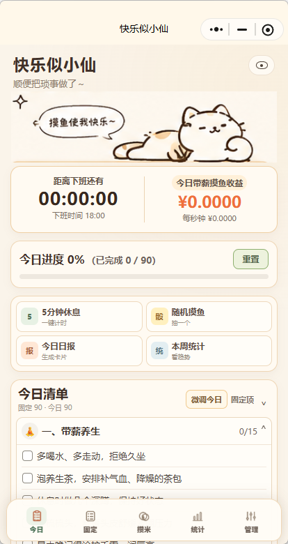

# 工休伴侣 · Workday Rhythm

从早上的清单到下班前的日报，在微信里安排工作日、查看工资进度并记录休息。工休伴侣把固定习惯与当天调整分开，让每日计划可以复用，也能随时改变。

**功能版本：V1.1.4 · 5 个 Tab + 日报页 · 数据仅存本机 · MIT 开源**



## 可以做什么

| 场景 | 功能 |
| --- | --- |
| 建立每日计划 | 90 条通用清单预设，条目与分类管理，可复用的固定模板 |
| 调整今天的任务 | 今日微调、条目新增/编辑/删除、日期级勾选与打卡 |
| 查看工作进度 | 月薪/日薪/时薪设置、实时工资估算、下班倒计时与时间占用分析 |
| 给自己留点休息 | 3/5/10/15 分钟快捷休息、手动计时、自定义类型与每日额度 |
| 回顾一周 | 近七日统计、连续使用、徽章、休息建议与本地日报图片 |
| 管理隐私和数据 | 隐身模式、金额隐藏、三档字号、回收站、本地 JSON 备份与恢复 |

工资显示为基于个人设置的估算值。金额隐藏设置同样用于日报图片，备份文件请自行妥善保管。

## 使用流程


条目库负责长期维护，固定模板决定每天的基础清单，今日微调只改变当天安排。运行数据保存在微信 Storage；日报通过本地 Canvas 生成。

## 运行

在微信开发者工具中导入包含 `project.config.json` 的根目录。`miniprogramRoot` 为 `miniprogram/`，公开 AppID 为 `touristappid`。真机调试时在本地配置自己的 AppID，提交前恢复占位值并运行隐私检查。

应用采用纯本地架构，包含五个 Tab 和一个日报页面。日报使用本地 Canvas 和相册 API。

## 验证与打包

需要 Python 3.10+、Node.js 22+，运行时无第三方依赖。

```sh
python tools/quality_gate.py --project .
node tools/privacy_test.js
python tools/prepublish_check.py
python tools/workflow.py all
```

全量工作流运行结构、语法、12 组业务回归与隐私检查，输出 `release/` 下 ZIP、SHA-256 和包内文件清单。GitHub Actions 自动运行离线回归。

## 本地数据

首次启动提供可编辑的通用清单；工资、打卡、计时和历史记录从个人设置与使用开始积累。

本地数据采用 Schema v5，使用 `moyu_workday_companion_state` / `moyu_workday_companion_schema_version` 存储键，并支持旧版本数据迁移。管理页可确认后恢复初始数据。导出的备份包含私人信息，不要上传仓库或公开 Issue。

## 参与贡献

欢迎通过 Issue 提交问题，或通过 Pull Request 改进项目。开发约定见 [CONTRIBUTING.md](CONTRIBUTING.md) 和 [AGENTS.md](AGENTS.md)。请使用虚构数据复现问题，避免提交私人记录、备份或真实 AppID。

## 许可与后续方向

代码使用 [MIT License](LICENSE)。数据与隐私边界见 [PRIVACY_AND_DATA.md](PRIVACY_AND_DATA.md)，人工验收项见 [QA_REPORT.md](QA_REPORT.md)。

界面支持自定义标题，随包插画采用项目素材。后续优先完善小屏与大字号体验、后台计时恢复和备份兼容性。
